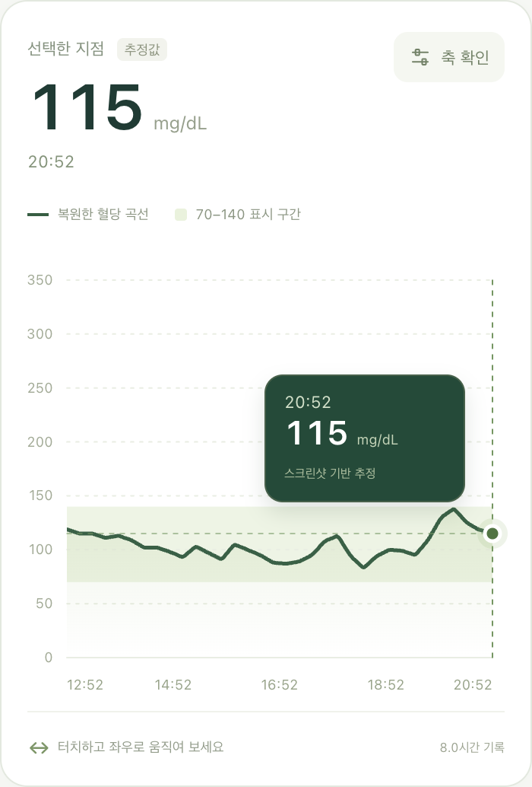

# Libre Lens · 리브레 렌즈

**스크린샷 속 혈당 그래프를 손끝으로 탐색하는, 설치 가능한 무료 웹앱.**

[앱 열기](https://seyongida.github.io/libre-lens/) · [문제 제보](https://github.com/seyongida/libre-lens/issues)

아이폰과 안드로이드에서 같은 주소로 사용할 수 있습니다. 사진과 혈당 정보는 서버로 전송하지 않습니다. OCR 모델까지 앱에 포함해, 첫 접속에서 준비가 끝나면 오프라인에서도 작동합니다.



## 사용 설명서

1. 앱을 열고 **스크린샷 불러오기**를 누릅니다. 처음에는 **사진 없이 샘플 체험**을 사용할 수 있습니다.
2. 샘플과 동일한 레이아웃의 세로형 LibreLink 전체 스크린샷을 선택합니다. 잘라내지 않은 PNG를 권장하며 JPG, WebP도 지원합니다.
3. 축과 검은 곡선이 자동으로 복원됩니다. **축 확인**에서 자동으로 읽은 시간 기준을 원본과 비교하세요. 판독이 불확실하면 시각을 표시하지 않으며, **오른쪽 끝 시각**과 **그래프 전체 시간**을 직접 입력합니다. 샘플은 오른쪽 끝 `20:52`, 전체 `8`시간입니다.
4. 그래프를 탭하거나 누른 채 좌우로 움직입니다. 해당 지점의 버블·십자선·정보 상자가 함께 이동합니다. 정보 상자는 가장자리에서 방향을 바꾸므로 화면 밖으로 잘리지 않습니다. 손을 떼면 마지막 지점이 남습니다.
5. **원본 비교**에서 인식한 그래프 영역을 확인합니다. **다른 스크린샷**으로 언제든 교체할 수 있으며 같은 사진도 다시 선택할 수 있습니다.
6. **CSV 저장**으로 복원한 추정값을 다운로드합니다. `time`, `day_offset`, `x_ratio`, `estimated_glucose_mg_dL` 열이 포함됩니다. 시간 미설정 상태에서는 시간·날짜 차이 열을 비워 둡니다.
7. **현재 사진 지우기**로 분석을 초기화합니다. 앱을 다시 열거나 새로고침하면 사진을 다시 선택해야 합니다. 개인 사진을 자동 저장하지 않습니다.

키보드에서는 그래프에 초점을 맞춘 뒤 `←` / `→`로 이동합니다. `Shift`와 함께 누르면 크게 이동하고, `Home` / `End`는 양 끝으로 이동합니다. 날짜 자체는 판독하지 않으며, 자정을 넘으면 오른쪽 끝 시각이 속한 날을 기준으로 **전날**을 표시합니다.

## 아이폰에 설치하기

1. **Safari**에서 [앱 주소](https://seyongida.github.io/libre-lens/)를 엽니다.
2. 공유 버튼 → **홈 화면에 추가**를 선택합니다. ‘웹 앱으로 열기’ 옵션이 보이면 켭니다.
3. 홈 화면의 **Libre Lens** 아이콘으로 실행합니다.
4. 하단에 **오프라인 준비 완료**가 표시될 때까지 첫 접속에서는 인터넷 연결을 유지합니다. OCR 파일을 포함해 약 11MB를 캐시합니다.

앱스토어, 개발자 서명, TestFlight 또는 케이블 연결이 필요하지 않습니다. [Apple의 홈 화면 웹앱 안내](https://support.apple.com/guide/iphone/iphea86e5236/ios)를 참고할 수 있습니다.

## 안드로이드에 설치하기

Chrome에서 앱 주소를 열고 메뉴 → **앱 설치** 또는 **홈 화면에 추가**를 선택하세요. 설치 안내 버튼이 제공되면 앱 내부 `?` 안내에서도 설치할 수 있습니다. 설치하지 않고 브라우저에서도 모든 분석 기능을 사용할 수 있습니다.

## 지원하는 스크린샷

| 항목 | 지원 범위 |
| --- | --- |
| 화면 | 제공된 샘플과 동일한 LibreLink 밝은 세로 화면 |
| y축 | 50–350 mg/dL의 7개 눈금, 아래쪽 0 기준선 |
| 곡선 | 검은색, 오른쪽의 초록색 현재값 원 선택적 지원 |
| 시간 눈금 | 고정 레이아웃의 두 위치(가로 약 26.5%, 64%)에 있는 한국어 오전/오후 또는 영어 AM/PM 숫자 |
| 파일 | PNG, JPG, WebP / 최대 25MB, 5천만 픽셀 |
| 크기 | 같은 화면을 비율 유지해 확대·축소한 이미지. 분석 시 폭 1,600px·높이 3,600px 이하로 축소 |
| 시간 보정 | 오른쪽 끝 시각 + 전체 5–12시간 범위 |

다크 모드, mmol/L, 잘린 이미지, 화면 비율이 달라 그래프 레이아웃 자체가 변한 스크린샷, 다른 앱의 그래프는 지원하지 않습니다. 오류 메시지가 나오면 샘플과 비교해 주세요. **시간 숫자만 바뀌는 경우는 자동 판독하지만, 눈금의 위치 자체가 변하는 다른 레이아웃은 추가 프로필 구현이 필요합니다.**

## 수치의 의미와 한계

이 앱은 원본 센서 데이터를 복구하지 않습니다. 이미지에 그려진 선의 중심을 따라 좌표를 추출하고, 축 비율로 시간·혈당을 환산합니다. 선의 두께, 압축, 해상도, 원본 앱의 그래프 보간에 따라 차이가 발생합니다. 버블 수치는 정수로 반올림한 **추정값**이며 CSV는 소수 첫째 자리까지 출력합니다. 분 단위 시간 역시 픽셀에서 환산한 추정입니다.

시간축은 두 눈금의 OCR 결과로 계산합니다. 오전/오후가 불확실하면 임의로 추측하지 않습니다. 상태 표시줄의 시각이 계산된 끝 시각과 3분 이내로 일치할 때만 픽셀 반올림 오차를 보정합니다. 수동으로 입력한 기준은 해당 사진에만 적용합니다.

이미지에서 곡선이 없는 큰 구간은 연결하지 않고 빈 구간으로 남깁니다. 인식률이 낮은 이미지는 결과를 내지 않습니다. 표시 구간 70–140은 원본 샘플의 배경을 재현한 것이며, 개인별 치료 목표나 정상 범위 판정이 아닙니다.

**치료·투약 결정에는 원래 앱과 의료진의 안내를 사용하세요.** Libre Lens는 Abbott 또는 FreeStyle Libre와 제휴한 제품이 아닙니다.

## 개인정보와 오프라인

- Canvas, Web Worker, 로컬 Tesseract OCR로 처리합니다. 사진 전송 API, 계정, 추적 코드, 외부 CDN을 사용하지 않습니다.
- 사진과 분석 결과는 열린 탭의 메모리에만 있습니다. LocalStorage·IndexedDB에 개인 사진이나 추출 결과를 저장하지 않습니다. OCR 라이브러리는 언어 모델을 캐시할 수 있습니다.
- 서비스 워커는 앱 코드, OCR 모델, 가상 데모만 캐시합니다. 사용자가 선택한 사진은 캐시에 넣지 않습니다.
- CSV는 사용자가 요청할 때 다운로드합니다. 다운로드한 파일은 사용자가 관리합니다.
- 브라우저가 사이트 데이터를 삭제하거나 저장 공간이 부족해 캐시를 제거하면 다시 온라인으로 접속해야 합니다. Safari 일반 탭과 홈 화면 앱은 저장 공간이 다를 수 있어 설치 후 앱에서도 한 번 온라인으로 여세요.
- 호스팅은 GitHub Pages입니다. 사이트 접속 자체에 대한 일반적인 호스팅 로그는 GitHub의 정책을 따릅니다.

## 개발 및 실행

Node.js **22 이상**이 필요합니다.

```sh
npm ci
npm run build
npm run dev
# http://localhost:4173
```

빌드는 `tessdata_fast/4.1.0`의 한국어·영어 학습 파일을 최초 한 번 다운로드해 `.cache/`에 보관합니다. 이후 빌드는 캐시를 재사용합니다. 실제 실행 시 모든 OCR 자산은 같은 사이트의 `vendor/`에서 로드합니다. 빌드 결과는 정적 파일만 있는 `dist/`입니다.

서비스 워커와 설치 기능은 HTTPS 또는 localhost에서 작동합니다. 같은 Wi-Fi의 휴대폰에서 로컬 HTTP 주소로 접근하면 분석은 사용할 수 있으나 오프라인·설치 기능은 제한됩니다. 실제 아이폰 설치 검증에는 HTTPS 배포 주소를 사용하세요.

```sh
npm test                       # 픽셀 분석·시간 계산·경계 처리
npx playwright install webkit   # macOS: Chrome 앱 설치 필요
npm run test:e2e                # Chrome + WebKit 브라우저 검증
npm run check                  # 단위 테스트 → 빌드 → 브라우저 검증
```

CI에서는 `npx playwright install --with-deps chromium webkit`으로 두 엔진을 설치합니다. 공개 테스트는 가상 데모를 사용합니다. 작업 폴더의 상위 경로에 `sample.png`가 있으면 사용자 제공 원본에 대한 추가 테스트도 실행하지만, 이 파일은 공개 저장소에 포함하지 않습니다.

브라우저 검증은 자동 OCR, 터치 가능한 그래프의 포인터 이동, 양 끝 정보 상자, 키보드 이동, 사진 재선택, 잘못된 파일, 수동 시간 보정, 자정 처리, CSV 다운로드, 화면 폭 320–1280px, 오프라인 새로고침과 OCR 재실행을 포함합니다. 브라우저 엔진 테스트는 실제 아이폰·안드로이드의 사진 선택기와 설치 UI를 완전히 대체하지 않습니다.

## GitHub Pages 배포

저장소 **Settings → Pages → Source → GitHub Actions**로 설정합니다. `main`에 push하면 `.github/workflows/pages.yml`이 단위·브라우저 테스트를 실행하고, 통과한 `dist/`만 배포합니다. Pull Request에서는 테스트만 실행합니다. 서브 경로 배포를 지원하며 API 키나 환경변수가 필요하지 않습니다.

다른 정적 호스팅에도 `dist/`를 그대로 게시할 수 있습니다. `file://`로 HTML을 직접 열면 ES modules, Worker, 서비스 워커가 동작하지 않으므로 HTTP(S) 서버를 사용하세요.

## 구조

```text
src/decoder.js               픽셀 분석, 축 비율 환산, 시간·정보 상자 계산
src/app.js                   사진 선택, OCR, SVG 그래프, 포인터·키보드, CSV
src/style.css                반응형 화면
public/                      앱 아이콘, manifest, 가상의 데모
scripts/build.mjs            로컬 OCR 자산 패키징, 콘텐츠 해시 서비스 워커
scripts/sw-template.js       오프라인 캐시와 버전 갱신
scripts/generate-assets.mjs  가상 데모와 아이콘 재생성
scripts/serve.mjs            개발용 정적 서버
tests/                       순수 함수·실제 브라우저 테스트
```

MIT License. OCR 구성요소의 별도 라이선스는 [THIRD_PARTY_NOTICES.md](THIRD_PARTY_NOTICES.md)를 확인하세요.
